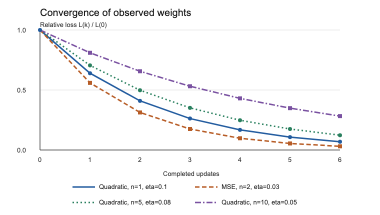

Работа реализует задание № 76 из списка лабораторных задач: ACOM-компонент принимает указатель на пользовательскую функцию потерь, шаг обучения и начальный вектор весов. Отчёт следует шести этапам образца для другой задачи, но рассматривает только многомерный градиентный спуск. Нативная сборка и консольный UnitTest на macOS arm64 подтвердили численный результат, обработку ошибок и получение снимков траектории через отдельный интерфейс. Отдельный консольный пример показывает эти снимки числами и ASCII-графиком. Сходимость произвольной функции потерь не гарантируется; достижение лимита итераций обозначается отдельно от признака сходимости.

# 1 Алгоритм

## Постановка и границы работы

По общей постановке новый компонент расширяет математические возможности ACOM. Для задания № 76 предметная операция — оптимизация функции по вектору весов. Она использует сложение и вычитание при вычислении пробных точек и обновлении весов, но не заменяет и не модифицирует опубликованные интерфейсы базового калькулятора. В доступных публичных заголовках проекта отдельный обязательный интерфейс калькулятора для подключения не найден. Поэтому расширение оформлено новым интерфейсом того же зарегистрированного компонента. Это проектное решение, не дополнительный алгоритм из задания.

Сохранены `CID_EcoLab1`, старый IID и порядок методов `IEcoLab1`, а также единственная зарегистрированная фабрика. Для задания повышенной сложности создан тип данных вектора. Матрица и перегрузки `int`, `long`, `float`, `long double` не добавлены: краткая формулировка № 76 требует именно вещественные веса и пользовательскую функцию потерь. Второй алгоритм и второй компонент не создавались, поскольку реализован один численный способ — градиентный спуск с центральными разностями.

## Публичный API и владение

IDL зафиксированы до C-заголовков. Все методы виртуальных таблиц принимают `me` первым параметром, используют `ECOCALLMETHOD` и Eco-типы `double_t`, `uint32_t`, `voidptr_t`, `bool_t`, `int16_t`.

`IEcoVector` имеет IID `66142D06-DCC4-4B5D-84EB-22F401BBC9DE` и методы `GetSize`, `GetValue`, `SetValue` после трёх методов `IEcoUnknown`. `IEcoArtificialIntelligence` имеет IID `D4366E09-1671-4880-B8BC-14E842996252` и методы `CreateVector`, `Optimize` после тех же методов управления интерфейсом. Не меняя эти интерфейсы, проект добавляет `IEcoOptimizationTrace` с IID `1C56BC65-1759-4278-80AF-4EDD861B2720` и методом `OptimizeObserved` для необязательных снимков весов. Это расширение проекта, а не требование краткой формулировки № 76.

`CreateVector` копирует положительное число конечных значений и возвращает клиенту одну ссылку на новый `IEcoVector`. Входной массив остаётся собственностью клиента. `Optimize` заимствует входной вектор и контекст на время вызова, не меняет вход и при успехе возвращает отдельный вектор с одной ссылкой. Клиент освобождает каждый полученный интерфейс через `Release`. `QueryInterface` добавляет ровно одну ссылку; `IID_IEcoUnknown` у обоих представлений оптимизатора возвращает один канонический указатель.

Сигнатура функции потерь:

```c
int16_t (ECOCALLMETHOD *EcoLossFunction)(
    const double_t* weights, uint32_t count,
    voidptr_t context, double_t* outLoss);
```

Callback вызывается синхронно. Пробный массив доступен только во время вызова; контекст принадлежит клиенту. Ненулевой статус callback возвращается без подмены. Потеря должна быть конечной. `Optimize` дополнительно принимает положительный шаг обучения, положительный предел итераций, положительный шаг конечных разностей и неотрицательный допуск градиента. Последние три параметра, критерий остановки и подробная семантика ошибок — решения проекта, не заданные прямо в краткой формулировке № 76.

Коды ошибок: `ERR_ECO_POINTER` для обязательного нулевого указателя, `ERR_ECOLAB1_INVALID_ARGUMENT` (1101) для размера или диапазона параметра, `ERR_ECOLAB1_INDEX_OUT_OF_RANGE` (1102), `ERR_ECOLAB1_NONFINITE` (1103), `ERR_ECOLAB1_NUMERIC_ERROR` (1104), `ERR_ECO_OUTOFMEMORY` для отказа аллокатора. Успех — `ERR_ECO_SUCCESS`, а не ошибочное написание из отдельных шаблонов. При ошибке выходной вектор равен `NULL`, остальные диагностические выходы обнулены; частичный результат не публикуется.

## Численный метод и остановка

Для каждой координаты в текущей точке `w` вычисляется `h_i = differenceStep × max(1, |w_i|)`. Затем вызывается пользовательская потеря в точках `w + h_i e_i` и `w − h_i e_i`; `g_i = (L_plus − L_minus) / (2h_i)`. Все `g_i` относятся к одной исходной точке. После расчёта всего градиента веса одновременно обновляются как `w_next_i = w_i − learningRate × g_i`.

Перед обновлением проверяется `max_i |g_i| ≤ gradientTolerance`. Если условие выполнено, возвращается копия текущего вектора, `outConverged = 1` и число фактически выполненных обновлений. При исчерпании `maxIterations` статус остаётся успешным, но `outConverged = 0`. Финальный вызов потери относится именно к возвращаемому вектору. Непредставимая пробная точка, нулевой знаменатель, NaN/Inf и отказ выделения прекращают расчёт с освобождением временных ресурсов.

# 2 Оценка сложности

Пусть `n` — число весов, `k` — число фактически выполненных проверок градиента, а `C_loss(n)` — стоимость одного вызова пользовательской функции потерь. Каждая проверка рассчитывает `n` производных по двум пробам, поэтому вызывает функцию потерь `2n` раз. После остановки следует ещё один вызов для результата: всего `2nk + 1`. При ранней остановке `k = outIterations + 1`, при достижении лимита `k = outIterations`.

В этой реализации перед каждой пробой копируются все `n` весов. Поэтому время одной проверки равно `O(n² + n·C_loss(n))`, а всего вызова — `O(k(n² + n·C_loss(n)) + n + C_loss(n))`. Если callback для квадратичной потери сам проходит по всем весам, `C_loss(n)=O(n)` и итог — `O(kn²)`; для иной модели стоимость callback может быть другой. Рабочие массивы весов, проб и градиента, а также возвращаемый вектор занимают `O(n)` памяти. Observer не добавляет обращений к потере; он получает `outIterations + 1` снимков и добавляет время своего собственного callback, но не хранит историю внутри компонента.

# 3 Улучшения

Центральная разность имеет ошибку аппроксимации порядка `O(h²)` для достаточно гладкой потери, тогда как односторонняя разность — `O(h)`; цена — две оценки потери на координату вместо одной. Масштабирование `h_i` по величине веса помогает сохранить представимую пробу для разных масштабов координат. Все производные считаются в одной точке, а веса обновляются одновременно, иначе результат зависел бы от порядка координат. Проверка нормы градиента позволяет завершить работу раньше лимита, а ошибки callback и аллокатора не оставляют частичный выходной вектор.

Эти свойства уже реализованы и проверены тестами; отчёт не приписывает им измеренного ускорения. Аналитический градиент, момент и адаптивный шаг не реализованы и не обозначаются как выполненные улучшения. Отдельный компонент второго алгоритма не нужен: задание № 76 не задаёт несколько обязательных способов градиентного спуска.

# 4 Результаты тестирования

## Консольная проверка и точность

Сборка выполнялась командой `sh Eco.Lab1/AssemblyFiles/Mac/build-native.sh`; запуск UnitTest завершился кодом 0. Отрицательный контроль с `LAB76_NEGATIVE_CONTROL=1` завершился кодом 77, поэтому неверное ожидание действительно делает консольный тест неуспешным. Тест проверяет создание и независимость вектора, размерности 1, 2 и 4, MSE, замену callback, смешанный член, раннюю остановку, лимит итераций, формулу числа вызовов, неверные входы, ошибки callback и аллокатора, NaN/Inf, повторные вызовы, сохранность входа и баланс ссылок. Дополнительные утверждения проверяют начальный и последующие снимки весов, численное равенство `OptimizeObserved` старому `Optimize`, нулевой контекст observer, отмену callback и получение всех интерфейсов через `QueryInterface`.

Независимый аналитический эталон для разделимой квадратичной потери `L(w)=Σ(w_i−t_i)^2` — минимум `w=t` и `L=0`. Для MSE модели `ŷ=w_0+w_1x` на четырёх точках `(x,y)=(0,1),(1,3),(2,5),(3,7)` минимум `(1,2)` и MSE 0. Утверждения исполняемого клиента дали следующие проверенные границы; они не выдаются за точные напечатанные значения весов.

| Сценарий | Начальная точка | Эталон | Проверенная точность |
|:---|:---|:---|:---|
| Квадратичная, 1 вес | `(1)` | `(-1)` | каждый вес `≤ 10⁻⁶`, потеря `≤ 10⁻¹¹` |
| Квадратичная, 2 веса | `(1, 2)` | `(-1, 0)` | каждый вес `≤ 10⁻⁶`, потеря `≤ 10⁻¹¹` |
| Квадратичная, 4 веса | `(1, 2, 3, 4)` | `(-1, 0, 1, 2)` | каждый вес `≤ 10⁻⁶`, потеря `≤ 10⁻¹¹` |
| MSE, 2 веса | `(0, 0)` | `(1, 2)` | каждый вес `≤ 10⁻⁵`, MSE `≤ 10⁻⁹` |
| Смешанный член, 1 шаг | `(0, 0)` | `(0.1, −0.35)` после одного шага | каждый вес `≤ 10⁻⁶` |

Для отдельного фиксированного сравнения в размерности 4 использованы начальные веса `(4,3,−2,1)`, цель `(1,−1,2,0.5)`, шаг `0.01`, шаг разностей `10⁻⁵` и 100 обновлений. Независимая аналитическая рекурсия даёт `w_i(100)=t_i+(w_i(0)−t_i)×0.98^100`, то есть `(1.3978586676842588, −0.46952177642098825, 1.4695217764209882, 0.5663097779473765)` и потерю `0.7255027974860118`. Исполняемые проверки подтвердили отклонение каждого веса компонента и независимой C-реализации от этого эталона не более `10⁻⁶`. В `math.h` нет стандартной функции многомерного градиентного спуска; для сравнения скорости использована самостоятельная C-реализация тех же формул, а аналитическое решение служит эталоном точности.

Дополнительно реальные строки терминального C-клиента сопоставлены внешним скриптом `AssemblyFiles/Mac/compare-python-reference.py` с NumPy 2.5.4 и SciPy 1.18.1. NumPy повторяет **тот же градиентный спуск** с теми же начальными весами, шагом обучения и шестью обновлениями, но использует аналитические градиенты квадратичной функции и MSE вместо центральных разностей. Скрипт проверяет каждый вес и потерю на всех семи снимках, а не только последнюю строку. C-клиент печатает шесть знаков после запятой, поэтому установлен допуск `5.1×10⁻⁷` — чуть больше половины единицы последнего разряда вывода. В таблице приведены фактически полученные потери после шестого обновления и наибольшее расхождение весов за всю траекторию:

| Задача | Потеря C, шаг 6 | Потеря NumPy, шаг 6 | Макс. `|Δw|` |
|:---|---:|---:|---:|
| Квадратичная, n=1 | 0.274878 | 0.274877907 | `1.11×10⁻¹⁶` |
| MSE, n=2 | 0.643395 | 0.643395479 | `4.30×10⁻⁷` |
| Квадратичная, n=5 | 6.787567 | 6.787566886 | `4.40×10⁻⁷` |
| Квадратичная, n=10 | 108.735372 | 108.735371545 | `3.55×10⁻¹⁵` |

Дополнительно публичная функция SciPy `differentiate.jacobian` численно вычислила градиент на каждом из шести шагов; максимальное расхождение весов с C-снимками составило `4.40×10⁻⁷` (квадратичная задача, `n=5`). Наибольшая ошибка потери среди двух Python-путей равна `4.79×10⁻⁷`, что укладывается в допуск отображения. Отдельный SciPy `optimize.minimize` с BFGS и численной схемой `jac='3-point'` нашёл минимумы с потерями от `2.59×10⁻²⁶` до `5.77×10⁻¹⁸`. BFGS — **другой** алгоритм: число его шагов не сравнивается с шестью шагами ACOM, а решение подтверждает положение известного минимума. NumPy и SciPy используются только снаружи компонента, в проверочном скрипте. MATLAB недоступен по учётной записи и не запускался.

## Производительность

Замер проводился на macOS 27.0.1 arm64, Apple Clang 21.0.0, сборка C89 `-O2`, `ECO_LIB`, `-fno-stack-protector`. Каждый исполняемый файл выполнил 100000 независимых запусков описанной задачи: размерность 4, по 100 обновлений и 801 вызову потери на запуск, всего 80100000 вызовов. Время измерено снаружи процесса через `time.perf_counter_ns()`; после прогрева выполнены три набора по пять чередующихся измерений. Значения ниже — медианы полного времени процесса в миллисекундах, включая запуск Eco.

| Повторный набор | ACOM компонент, мс | Независимый C эталон, мс | Отношение |
|:---|---:|---:|---:|
| Первый | 494.143584 | 218.541375 | 2.26 |
| Второй | 495.720125 | 218.735292 | 2.27 |
| Третий | 494.452625 | 219.219708 | 2.26 |

Полные пятнадцать отсчётов находятся в `DesignFiles/Lab76-verification.md`; повторяемость проверена тремя отдельными вызовами измерительного скрипта. Замер использует прежний `Optimize` без observer; стоимость визуализации в эти числа не входит. Разница включает ACOM-диспетчеризацию, проверки входов и арифметики, копирование и выделение выходного вектора. Она не является измерением одного арифметического цикла. Эталонный C-клиент и внешний Python-измеритель не подключены к реализации компонента.

## Сравнительный анализ

Сравнение точности выполнено при одинаковых начальных весах, шагах обучения и шести обновлениях. Для всех семи снимков в каждой из четырёх задач веса ACOM согласуются как с аналитическим градиентом NumPy, так и с численным градиентом SciPy в пределах `5.1×10⁻⁷`. Наибольшее наблюдаемое расхождение веса — `4.40×10⁻⁷`, потери — `4.79×10⁻⁷`. Эти величины относятся к **напечатанным** C-клиентом шести знакам после запятой: они подтверждают совпадение отображаемой траектории, но сами по себе не измеряют ошибку внутренних значений `double_t` с точностью лучше округления вывода. Для исходных значений без этого округления в UnitTest отдельно использованы аналитические эталоны и допуски, указанные выше.

После шести шагов потеря уменьшилась в каждом примере: с `4` до `0.274878` при `n=1`, с `21` до `0.643395` для MSE, с `55` до `6.787567` при `n=5` и с `385` до `108.735372` при `n=10`. Ненулевая конечная потеря ожидаема при фиксированном бюджете в шесть обновлений и не противоречит минимуму `0`, найденному SciPy BFGS. Абсолютные потери между примерами нельзя ранжировать как качество алгоритма: различаются функция, масштаб начальных весов и шаг обучения. Например, в двух многомерных квадратичных задачах точная рекурсия даёт отношения конечной потери к начальной `(1−2η)^12`: около `0.1234` при `η=0.08`, `n=5`, и `0.2824` при `η=0.05`, `n=10`. Разница объясняется в том числе разными шагами обучения, а не только размерностью.

Для скорости сопоставлены именно ACOM и самостоятельный C-эталон, исполняющие одинаковую схему центральных разностей, одну функцию потерь и по `801` её вызову за запуск. Три медианы дают отношение полного времени `2.26–2.27`: в этих условиях ACOM медленнее эталона. Замер включает не только вычисление градиента, поэтому нельзя приписать весь разрыв одной диспетчеризации или одному выделению памяти. В `math.h` нет готового многомерного оптимизатора; время Python-скрипта с NumPy и SciPy здесь не сопоставляется с C, поскольку у него иная среда исполнения, а у BFGS ещё и другой алгоритм. Следовательно, таблица подтверждает накладные расходы всей проверяемой компонентной реализации относительно выбранного C-аналога, но не задаёт универсальное соотношение скоростей с Python или MATLAB.

## Сборка и ограничения

Нативный путь Apple Clang собрал статический архив, UnitTest и два исполняемых файла для сравнения; все они запускались. `plutil -lint` подтвердил синтаксис двух Xcode-проектов. `xcodebuild` недоступен: активен только `/Library/Developer/CommandLineTools`, поэтому сборка именно через Xcode не заявляется. Linux и EcoOS Makefile проверены через `make -n`, но соответствующие toolchain из проекта не исполняются нативно на macOS arm64. Собственные исходники и объектные файлы проверены на прямые и неявные libc-символы и незаменённые маркеры шаблонов; проверка прошла. Готовые архивы `Eco.Framework` могут иметь собственные зависимости от системных библиотек — запрет проверялся на исходниках и объектах разработанного компонента и клиента, а не на стороннем готовом рантайме Eco.

# 5 Поддержка других компонентов

Компонент участвует в существующей ACOM-инфраструктуре: фабрика зарегистрирована в `IEcoInterfaceBus1`, через шину запрашивает `IEcoMemoryAllocator1`, а при создании получает `IEcoSystem1`. В UnitTest проверены получение старого `IEcoLab1`, оптимизатора и нового интерфейса наблюдения через фабрику и взаимный `QueryInterface`, общий канонический `IEcoUnknown`, дополнительные ссылки и их освобождение. Оптимизатор использует другой ACOM-объект данных `IEcoVector`, созданный без отдельной регистрации. Тестовый аллокатор с искусственным отказом подтвердил освобождение ресурсов на пяти позициях выделения; отдельный запуск подтвердил отсутствие утечки при ошибке observer после первого обновления.

Раздел 5 образца описывает включение и агрегирование калькуляторов A/B/D/E по заданию его второй лабораторной. Для № 76 это не указано, а доступный macOS набор зависимостей не содержит готовых калькуляторов. Поэтому отчёт не выдаёт существующую работу с System, InterfaceBus и MemoryAllocator за реализацию включения или агрегирования калькуляторов. Одна фабрика и прежний `CID_EcoLab1` сохранены.

# 6 Визуализация

Для наблюдения за ходом вычислений создан `IEcoOptimizationTrace::OptimizeObserved`. Синхронный `EcoIterationObserver` принимает `const double_t* weights`, число весов, число завершённых обновлений и клиентский контекст; статус `int16_t` может прервать работу. Первый вызов показывает начальный вектор с индексом 0, каждый следующий — полностью обновлённый вектор. Память массива принадлежит компоненту только на время callback. Ошибка observer возвращается без публикации частичного результата, но уже выполненные действия клиента не откатываются. Старый `Optimize` работает без наблюдения и не меняет API.

UnitTest проверил `L(w)=w²` из `w=2` при шаге 0.1, шаге разностей `10⁻⁵`, нулевом допуске и трёх обновлениях. Снимки `2`, `1.6`, `1.28`, `1.024` совпали с эталоном до `10⁻⁶`, последний — с результатом до `10⁻⁹`. Функция потерь вызвана семь раз, как и без observer. Также проверены единственный начальный снимок при ранней остановке и ошибки observer на первом и втором вызовах.

Запуск из корня `Dev`: `sh Eco.Lab1/AssemblyFiles/Mac/run-visualization.sh`. Скрипт выполняет UnitTest, затем отдельный C89-клиент. Через фабрику и `QueryInterface` клиент получает интерфейсы, записывает снимки `OptimizeObserved` файловым сервисом Eco; оболочка выводит файл только после успешного завершения. Номер шага, потеря и полоса выровнены; веса стоят ниже, для `n=10` — двумя группами по пять. ABI и алгоритм компонента не меняются.

Выбранные строки вывода для `L(w)=w²`, начального веса 2, шага обучения 0.1, шести обновлений и шага разностей `10⁻⁵`:

```text
step |       loss | relative loss
-----+------------+------------------------------
   0 |   4.000000 | ##############################
     | w[0] = 2.000000
   6 |   0.274878 | ##
     | w[0] = 0.524288
```

Для MSE модели `ŷ=w₀+w₁x` на точках `(0,1)`, `(1,3)`, `(2,5)`, `(3,7)` использованы начальные веса `(0,0)`, шаг обучения 0.03 и те же шесть обновлений. Выбранные строки:

```text
step |       loss | relative loss
-----+------------+------------------------------
   0 |  21.000000 | ##############################
     | w[0..1] = 0.000000  0.000000
   6 |   0.643395 | #
     | w[0..1] = 0.787581  1.667689
```

После шестого обновления MSE составила `0.643395` при весах `(0.787581, 1.667689)`; полный путь выводит команда.

## Многомерные примеры

Чтобы явно показать многомерный метод, клиент выполняет ещё два запуска для `L(w)=Σ(wᵢ−i)²`, где `wᵢ(0)=2i+1`. При `n=5` и `η=0.08` получены:

```text
step |       loss | relative loss
-----+------------+------------------------------
   0 |  55.000000 | ##############################
     | w[0..4] = 1.000000  3.000000  5.000000  7.000000  9.000000
   3 |  19.321392 | ###########
     | w[0..4] = 0.592704  2.185408  3.778112  5.370816  6.963520
   6 |   6.787567 | ####
     | w[0..4] = 0.351298  1.702596  3.053894  4.405192  5.756490
```

При `n=10` и `η=0.05` начальная потеря `385.000000`, после шестого обновления — `108.735372`. Все координаты показаны двумя одинаковыми группами:

```text
step |       loss | relative loss
-----+------------+------------------------------
   0 | 385.000000 | ##############################
     | w[0..4] = 1.000000  3.000000  5.000000  7.000000  9.000000
     | w[5..9] = 11.000000  13.000000  15.000000  17.000000  19.000000
   3 | 204.604785 | ################
     | w[0..4] = 0.729000  2.458000  4.187000  5.916000  7.645000
     | w[5..9] = 9.374000  11.103000  12.832000  14.561000  16.290000
   6 | 108.735372 | ########
     | w[0..4] = 0.531441  2.062882  3.594323  5.125764  6.657205
     | w[5..9] = 8.188646  9.720087  11.251528  12.782969  14.314410
```

Для этих двух задач каждая координата каждого из семи снимков проверена **до округления** по независимой аналитической рекурсии `wᵢ(k)=i+(i+1)(1−2η)^k` с допуском `10⁻⁶`. Все координаты градиента относятся к одному исходному вектору шага и затем обновляются одновременно. Каждая полоса сравнивает потерю с начальной потерей **своего** примера: 30 символов `#` соответствуют строке 0; значения рядом округлены до шести знаков после запятой. Поэтому график показывает спад, а не абсолютное сравнение шкал разных функций. Потери для изображения повторно вычислены клиентом на полученных снимках по той же формуле; это не дополнительные вызовы оптимизатора. Сам оптимизатор сделал соответственно 13, 25, 61 и 121 вызовов функции потерь для `n=1`, `2`, `5` и `10` (`2n × 6 + 1`). Последние снимки сверены с возвращёнными векторами до округления, входные векторы остались прежними. Это воспроизводимая **терминальная визуализация**, а не графическое окно. В собственных C-объектах нет прямых вызовов libc; внешний shell используется только для запуска и показа текстового файла.

{width=5.7in}

# 7 Инжиниринг промптов и автоматизация разработки

## Инструменты, контекст и ответственность

При подготовке лабораторной я использовал **GPT-6-SOL с уровнем рассуждения extra high** как ассистента для анализа требований, проектирования интерфейсов, подготовки исходников, тестов и отчёта. Режим модели — выбранная мной настройка работы, а не свойство или зависимость скомпилированного компонента. ИИ помогал сопоставлять источники и находить проверяемые варианты решения; ответственность за выбор контракта и подтверждение результата оставалась за мной. Я не считал ответ модели доказательством корректности: итоговые утверждения ниже опираются на исходники и фактически запущенные проверки.

Контекст я распределил между рабочим запросом и файлами проекта. В запросе оставил цель лабораторной и критерии готовности; долговременные правила вынес в файлы, которые агент перечитывает при следующем изменении. `architecture.md` описывает границы компонента и клиента, а `AGENTS.md` задаёт порядок работы: сначала сверить PDF задания, лекции и публичные заголовки Eco, затем подготовить контракт, код, тесты и отчёт. Там же записан приоритет источников при расхождении и запрет считать каркас или шаблон готовым решением. Это рабочая инструкция агенту, а не часть скомпилированного компонента и не замена заданию преподавателя.

`codestyle.md` я сформировал как применимые к задаче правила из нескольких источников. Из PDF взяты запрет libc и требование консольного UnitTest; из лекций 02–03 и реальных заголовков Eco — устройство `IEcoUnknown`, порядок `QueryInterface`/`AddRef`/`Release`, типы, вызовы и владение ссылками. Соглашения C89, имена и структура файлов сопоставлены с Makefile, каркасом и выборочными материалами `Eco.AI.Promts`: `Stack/ru/acom.md`, `Stack/ru/c.md`, `Skills/ru/eco-code-gen.md` и шаблонами. Правила о четырёх пробелах, длине строк и языке комментариев отмечены как локальный выбор. Для градиентного спуска добавлены конкретные проверки чисел, памяти, ABI и тестовых сценариев. Я не переносил шаблоны слепо: например, встречающееся там `ERR_ECO_SUCCESES` заменено реальным `ERR_ECO_SUCCESS` после сверки с заголовком. Образцы отчётов из `docs/` помогали оформлению, но алгоритмы сортировки из них не использовались.

## Итоговая инструкция и её уточнение

Ниже — **консолидированный текст рабочей инструкции** для генерации и проверки; он передаёт существенные ограничения фактически использованного задания и проектных правил, а не выдаётся за дословную стенограмму всех обращений к модели:

> Ты — системный разработчик переносимого C89-компонента Eco ACOM для задачи № 76. Сначала прочитай задание, `AGENTS.md`, `architecture.md`, `codestyle.md`, относящиеся материалы `docs/`, публичные заголовки Eco и текущий каркас. До изменения ABI оформи контракт и сценарии в OpenSpec; сначала IDL, затем согласованные C-заголовки. Сохрани `CID_EcoLab1`, старый `IEcoLab1`, его IID и порядок методов; используй одну фабрику. В каждом методе VTbl передавай `me` первым, разделяй `in`/`out`, применяй `ECOCALLMETHOD` и реальные Eco-типы. Реализация не должна прямо или неявно вызывать libc и сторонние библиотеки; память выделяй только через `IEcoMemoryAllocator1`. Проверяй `NULL`, размеры, переполнение, конечность чисел и все ошибки callback/аллокатора; не публикуй частичный результат. Вычисляй центральные разности в одной исходной точке и обновляй все веса одновременно. Доказывай результат консольным UnitTest, независимым эталоном, проверкой символов объектов, воспроизводимым замером и отчётом; не заявляй недоступную сборку как успешную.

Уточнения развивались по наблюдаемым рискам. Сгенерированный каркас содержал `MyFunction`, а отдельные шаблоны — ошибочное `ERR_ECO_SUCCESES`: поэтому в инструкции закреплены проверка реальных Eco-заголовков, сохранение опубликованного ABI и удаление маркеров шаблонов. Возможность получить формально похожий, но неверный градиент закрыта требованием считать все координаты в одной точке, проверкой смешанной квадратичной функции и аналитической рекурсией. После добавления наблюдаемой траектории первая форма консольной таблицы оказалась неудобной для чтения: по замечанию к визуализации уточнены выравнивание колонок и разбиение десяти весов на две группы; повторная проверка сопоставила 31 строку отчёта с живым выводом. Это история уточнения требований и исправления представления результата; она не приписывает модели незафиксированные ошибки или автоматическую «гарантию» правильности.

## OpenSpec и проверяемые изменения

OpenSpec — инструмент разработки по спецификациям: изменение сначала описывается в читаемых файлах. В проекте выбран режим `spec-driven` из [официальной документации OpenSpec](https://openspec.dev/docs/schemas/spec-driven). В каталоге каждого изменения `proposal.md` объясняет причину; `specs/.../spec.md` задаёт поведение и сценарии «когда — тогда»; `design.md` фиксирует способ реализации; `tasks.md` связывает её с проверками. OpenSpec не является библиотекой ACOM и не вычисляет градиент при запуске программы.

Я использовал этот порядок из-за цены ошибки в публичном ABI: поздняя смена IID, порядка VTbl или владения выходным вектором нарушила бы согласованность клиента и компонента. Первое изменение закрепило `IEcoVector`, `IEcoArtificialIntelligence`, сигнатуру callback, параметры шага, центральные разности, остановку и ответы на ошибки. Например, сценарий требует при ошибке callback вернуть её статус, оставить входные веса прежними и не выдавать частичный результат. Во втором изменении наблюдение траектории добавлено через новый IID, не меняя старые методы. Третье описывает консольные шаги для `n=1, 2, 5, 10` и сверку снимков с вычисленными значениями. Так каждый этап можно сопоставить с требованием, исходником и тестом.

Строгая команда `openspec validate ... --strict` успешно проверила все три пакета изменений. Она проверяет структуру и форму требований со сценариями, но не доказывает правильность машинного кода. Отмеченные выполненными пункты `tasks.md` я сопоставил со сборкой, запуском UnitTest, сравнением с независимым численным эталоном и проверкой отсутствия запрещённых вызовов libc. Файлы OpenSpec остаются записью причин, решений и критериев приёмки; у скомпилированного компонента нет зависимости от них.

## Проверенный фрагмент и контроль результата

Пример фрагмента итогового C-кода, подготовленного при поддержке ИИ и затем сверенного с проектным контрактом, — копирование пробного вектора и вызов пользовательской потери в `CEcoLab1_Evaluate`:

```c
for (i = 0; i < count; ++i) {
    trial[i] = base[i];
}
if (useProbe) {
    trial[probeIndex] = probeValue;
}
result = loss(trial, count, context, outLoss);
if (result != ERR_ECO_SUCCESS) {
    return result;
}
if (!EcoLab1IsFinite(*outLoss)) {
    return ERR_ECOLAB1_NONFINITE;
}
```

Здесь копирование выполняется явным циклом без `memcpy`, callback не зашит под MSE, его ошибка сохраняется, а нечисловая потеря отклоняется. Сигнатура и границы владения приведены в разделе 1; полный путь освобождения ресурсов находится в реализации. Фрагмент не является самостоятельным доказательством: нативный UnitTest завершился успешно, отрицательные контроли дали ненулевой код, численные результаты сопоставлены с аналитическим эталоном, а исходники и объектные файлы проверены на libc-символы. Замеры в разделе 4 получены отдельным запуском на указанных данных; возможная недоступность Xcode и Linux/EcoOS названа прямо. Таким образом, ИИ ускорил подготовку и ревизию решения, но заключение о работоспособности основано на воспроизводимых проверках, а не на авторитете модели.

# Вывод

Задание № 76 выполнено в рамках одного ACOM-компонента с интерфейсом оптимизатора, отдельным интерфейсом вектора и необязательным интерфейсом наблюдения. Пользовательская функция потерь и контекст не привязаны к MSE или конкретной модели. UnitTest подтвердил численную точность, семантику остановки, ошибки, владение ссылками и траекторию; отдельный запуск показывает первые шаги при 1, 2, 5 и 10 весах в терминале. Сравнение всех снимков с NumPy и независимые минимумы SciPy подтвердили численный результат в пределах указанного допуска вывода. Замеры показывают цену компонентной оболочки относительно самостоятельной C-реализации при одинаковой математической нагрузке. Ограничение сдачи — отсутствие нативной проверки Xcode и Linux/EcoOS на этой машине; рабочая сборка и запуск на macOS arm64 воспроизводимы приложенными скриптами.
